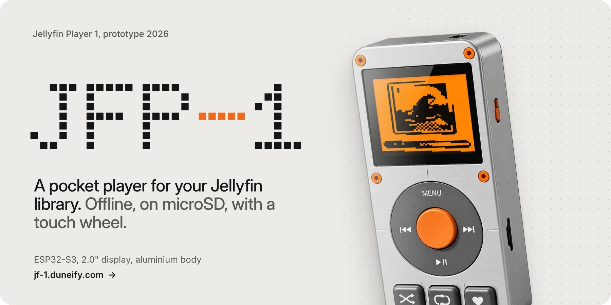
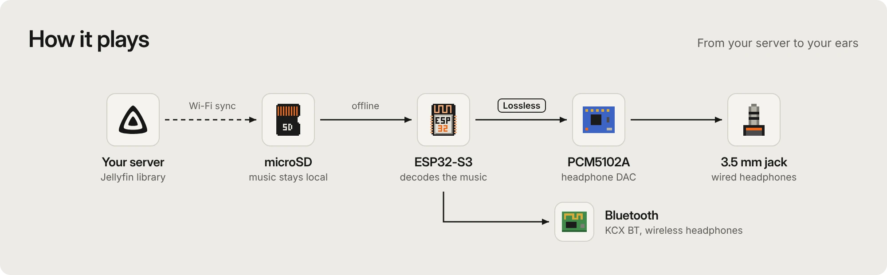
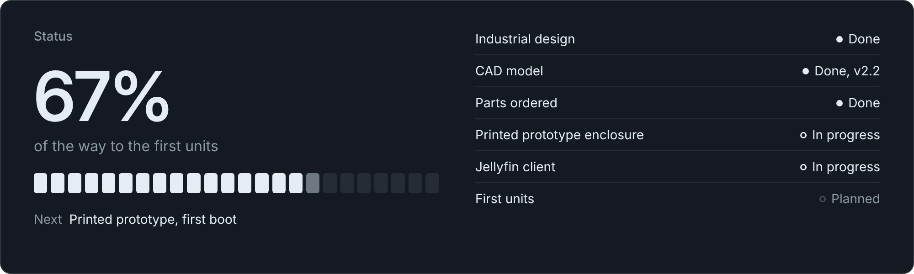
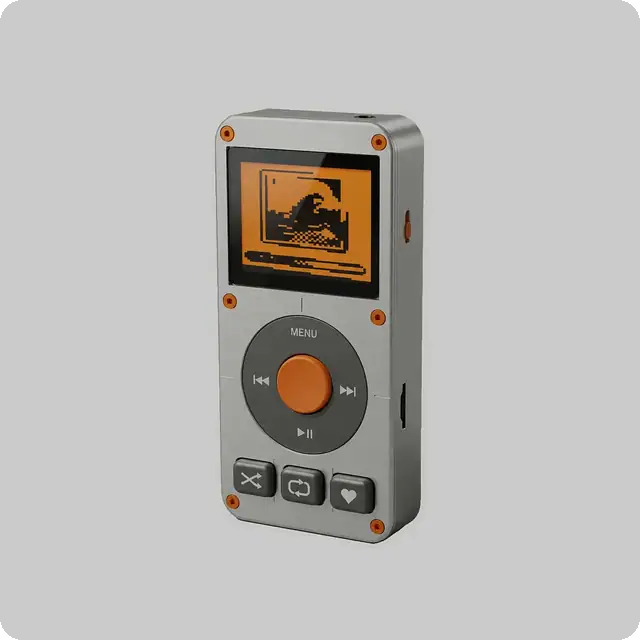
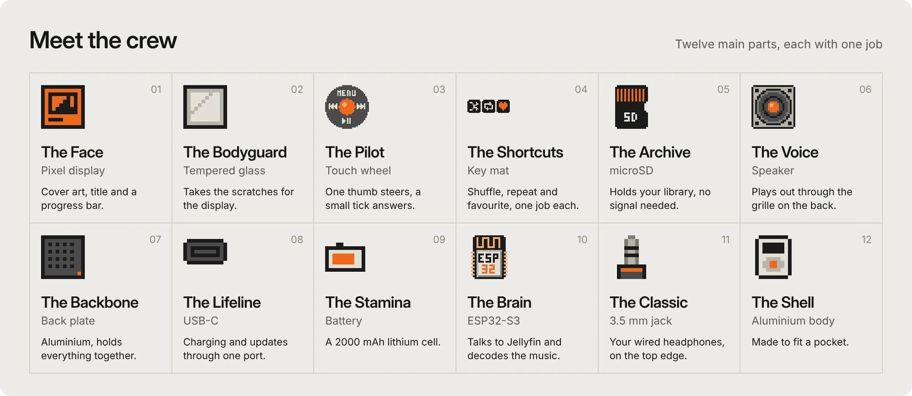
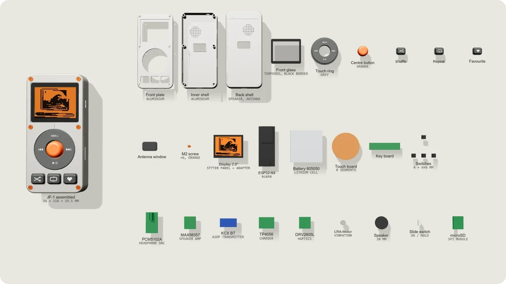
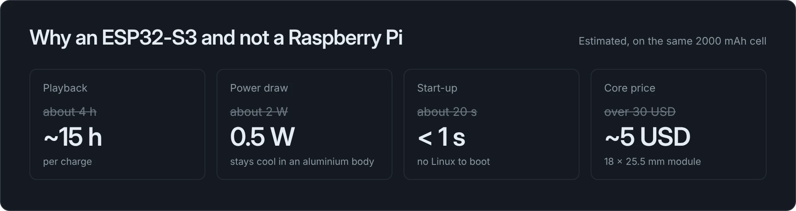

<a href="https://jf-1.duneify.com"></a>

<p align="center">
  <a href="https://jf-1.duneify.com"><b>Website</b></a> &nbsp;·&nbsp;
  <a href="https://jf-1.duneify.com/#log">Build log</a> &nbsp;·&nbsp;
  <a href="https://jf-1.duneify.com/#join">Waitlist</a>
</p>

<br>

JFP-1, short for Jellyfin Player 1, is a pocket music player for your own Jellyfin library. It syncs with your server over Wi-Fi, keeps the music on microSD and plays it offline in lossless quality. A touch wheel on the front does the steering. There is no feed and no algorithm deciding what comes next.

It plays on the train, in the mountains and on a plane, with no signal needed.

This repository holds the landing page at [jf-1.duneify.com](https://jf-1.duneify.com). The hardware and the firmware are still in the prototype stage.

<br>

## How it plays



<br>

## Status



<br>

## Inside

<table>
  <tr>
    <td width="50%" valign="top">
      
    </td>
    <td width="50%" valign="top">
      <p>Twelve main parts, each with one job. Below them, ten smaller boards and motors do the quiet work. The ESP32-S3, audio, charging and haptics share one custom PCB made through LCSC, so the inside needs fewer cables and every unit gets the same board.</p>
      <table>
        <tr><td><sub>CORE</sub></td><td>ESP32-S3 N16R8, 16 MB flash, 8 MB PSRAM</td></tr>
        <tr><td><sub>DISPLAY</sub></td><td>2.0" IPS, 240 x 320, ST7789</td></tr>
        <tr><td><sub>FRONT</sub></td><td>Tempered glass</td></tr>
        <tr><td><sub>INPUT</sub></td><td>Touch wheel, centre button, shuffle, repeat, favourite</td></tr>
        <tr><td><sub>AUDIO</sub></td><td>Lossless over the 3.5 mm jack, plus Bluetooth</td></tr>
        <tr><td><sub>STORAGE</sub></td><td>microSD, synced over Wi-Fi</td></tr>
        <tr><td><sub>BATTERY</sub></td><td>2000 mAh, charges over USB-C</td></tr>
        <tr><td><sub>BODY</sub></td><td>Aluminium, 56 x 118 x 19.5 mm</td></tr>
      </table>
    </td>
  </tr>
</table>

<br>



<br>



<details>
<summary><b>The smaller boards</b></summary>
<br>

| Part | Job |
| --- | --- |
| PCM5102A | Headphone DAC, a clean signal for wired headphones |
| MAX98357 | Amp for the speaker |
| KCX BT | Sends music to Bluetooth headphones |
| DRV2605L | Drives the vibration motor and the haptic disc |
| TP4056 | Charges the battery over USB-C |
| Wheel sensor | Reads every turn of the touch wheel |
| Button board | Turns each key press into a command |

The speaker is still an open question. It is not certain it fits in the body next to everything else. The first prototype carries it, and whether it stays is the first change up for a community vote.

</details>

<br>

## Why an ESP32-S3

JFP-1 started out with a Raspberry Pi and a SIM card that streamed the library over mobile data. A full Linux system costs too much power, heat and time for a player that lives in a pocket.



<br>

## Build log

The full log with images lives on the [website](https://jf-1.duneify.com/#log). The hardware steps so far:

| Date | Step |
| --- | --- |
| 7 Nov 2026 | First run of the custom JFP-1 board started at LCSC |
| 6 Nov 2026 | Decision: one custom PCB instead of separate breakout boards |
| 5 Nov 2026 | CAD model at v2.2, parts list written and ordered |
| 4 Nov 2026 | Costs brought down by putting the chips straight onto one board |
| 3 Nov 2026 | Every part priced, from the ESP32-S3 down to the M2 screws |
| 2 Nov 2026 | Parts picked for the ESP32-S3 build |
| 1 Nov 2026 | Decision: ESP32-S3 instead of a Raspberry Pi |
| 31 Oct 2026 | First plan with a Raspberry Pi and a SIM card |

<br>

## Run the page locally

The site is plain HTML with no build step. It runs on GitHub Pages.

```bash
git clone https://github.com/AbbadonTRD/JFP-1.git
cd JFP-1
python -m http.server 8000
```

Then open `http://localhost:8000`.

<br>

<sub>Designed and built by <a href="https://github.com/AbbadonTRD">Tiago Cevallos</a> in Switzerland. Hardware and software come from the same desk.</sub>
